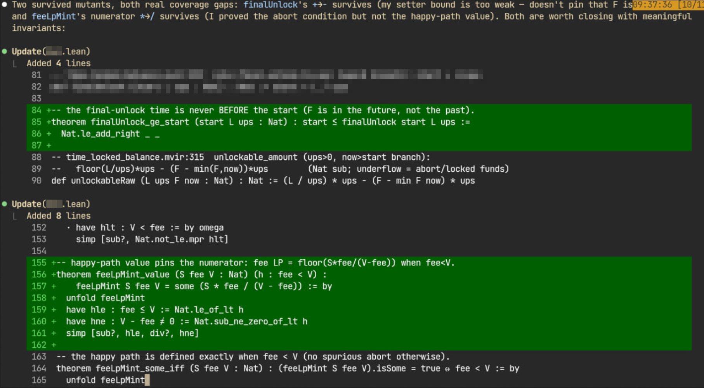

# Mutate.lean — mutation testing for Lean4 proofs
Checks that your theorems actually constrain your `def`s. It mutates `def`/`instance`/`abbrev` bodies, re-elaborates each mutant in-process, and classifies via the compiler:

This is a small library which depends on Lean >=4.28 only.

## Usage
Run it from the target project's `lake` dir:
```
cd <your-lean-project>
lake env lean --run /path/to/Mutate.lean/MutateRun.lean YourModel.lean
```

Output: one line per mutant `  <def>  <op>  <verdict>  <killer-theorem>`, then a summary `killed=.. survived=.. stillborn=..`. A clean run is `survived=0` (modulo provably-equivalent noise).
- **killed** — some theorem/`example` now fails to elaborate => that operator is constrained. Good.
- **stillborn** — the mutant is ill-typed. Skip.
- **survived** — everything still compiles with the mutated def => a coverage gap. Add an invariant.

## Use-cases
The main purpose of the library is to **get extra feedback to LLMs writing specifications**.

This tool gives the model cheap, fast feedback, so the generated code is more complete before manual review. Example — proving some Move smart-contract properties:



It works great with small isolated spec files describing math algorithms.

For good-quality hand-written specs the tool generates mostly noise, while it is still capable of highlighting some specification gaps or finding dead code.
